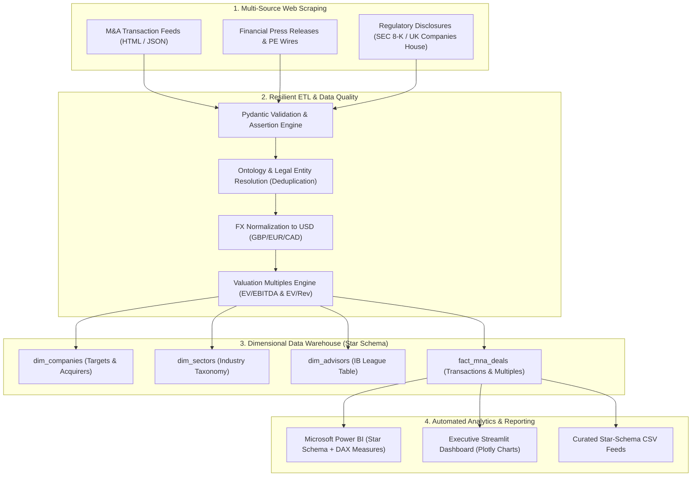

# DealPulse M&A: Automated Intelligence Pipeline & Valuation Platform

[](https://www.python.org/)
[](https://pola.rs/)
[](https://www.postgresql.org/)
[](https://powerbi.microsoft.com/)
[](https://github.com/)
[](LICENSE)

An institutional-grade, automated data pipeline and market intelligence platform designed for **Mid-Market Investment Banking** and **Private Equity Deal Sourcing** across the UK, US, and European markets.

DealPulse automates the end-to-end lifecycle of transaction intelligence: multi-source web scraping, entity resolution, currency normalization (GBP/EUR to USD), valuation multiple calculation (EV/EBITDA, EV/Revenue), dimensional database modeling, and automated executive reporting for **Power BI** and interactive web dashboards.

---

## 🏛️ Business Context & Investment Banking Value

In mid-market M&A, speed and valuation precision are critical:
- **Deal Sourcing**: Automatically flags acquisitions, carve-outs, and secondary buyouts within hours of public disclosure.
- **Valuation Benchmarks**: Provides real-time percentile distribution (Median, P25, P75) of EV/EBITDA multiples by sub-industry to assist investment bankers in preparing valuation pitchbooks.
- **Sponsor Tracking**: Segregates Private Equity dry powder deployment from Corporate Strategic acquirers to identify active consolidators.

---

## 🏗️ Architecture & Pipeline Flow



---

## 🎯 Key Technical Capabilities

### 1. Advanced Web Scraping & Multi-Source Extraction
- **Resilient Base Scraper**: Built with automatic session management, user-agent headers, exponential backoff retries (`429`, `5xx`), and rate-limiting delays to replace fragile one-off scrapers.
- **Multi-Source Sourcing**: Ingests unstructured transaction cards, corporate press releases, and regulatory public disclosures.

### 2. Data Cleaning, Ontology & Entity Resolution
- **Ontology Enforcement**: Cleans corporate legal suffixes (`Inc.`, `LLC`, `GmbH`, `plc`) and applies deterministic entity matching to eliminate duplicate records.
- **Taxonomy Mapping**: Maps diverse industry tags into standard investment banking sectors (*Enterprise Software*, *FinTech*, *MedTech*, *Cybersecurity*, *CleanTech*).
- **High-Performance Processing**: Implements both **Pandas** and **Polars** engines for fast numerical transformations.

### 3. Dimensional Relational Modeling (Star Schema SQL)
- Strict relational schema adhering to Kimball dimensional standards:
  - `dim_companies`: Normalizes targets, acquirers, and PE sponsors.
  - `dim_sectors`: Standardized sub-industries and sector descriptions.
  - `dim_advisors`: Investment banks and financial advisory league tables.
  - `fact_mna_deals`: Transaction multiples, native values, USD normalized sizes, and data lineage.
- Pre-compiled SQL views: `v_sector_valuation_benchmarks`, `v_buyer_strategy_comparison`, and `v_advisor_league_table`.

### 4. Microsoft Power BI Integration & DAX Measures
- Ready-to-import Star Schema model with 1-to-many relationships.
- Pre-formulated DAX measures for executive reporting:
  - **Median EV/EBITDA Multiple**: `MEDIAN(fact_mna_deals[ev_to_ebitda_multiple])`
  - **Total Capital Deployed**: `SUM(fact_mna_deals[deal_value_usd])`
  - **Private Equity Penetration Rate %**: Custom sponsor share calculation.
  - Complete implementation guide in [`dashboard/powerbi_instructions.md`](dashboard/powerbi_instructions.md).

### 5. Linux Automation, Shell Scripting & CI/CD
- **Production Shell Script**: [`scripts/run_pipeline.sh`](scripts/run_pipeline.sh) with error trapping (`set -euo pipefail`), automated log file archiving, and cron capability.
- **GitHub Actions Workflow**: [`.github/workflows/daily_pipeline.yml`](.github/workflows/daily_pipeline.yml) running daily scheduled ETL at 06:00 UTC (matching London market open), executing automated pytest quality checks, and archiving curated datasets.

---

## 📂 Repository Structure

```text
dealpulse-mna-platform/
├── .github/
│   └── workflows/
│       └── daily_pipeline.yml          # GitHub Actions scheduled ETL workflow
├── src/
│   ├── config.py                       # Project configuration, paths, FX rates, logger
│   ├── scrapers/
│   │   ├── base_scraper.py             # Resilient base scraper with backoff retries
│   │   ├── mna_deals_scraper.py        # M&A portal deal card scraper
│   │   ├── financial_news_scraper.py   # PR Newswire / PE announcement scraper
│   │   └── sec_filings_scraper.py      # SEC 8-K & UK Companies House disclosures
│   ├── pipeline/
│   │   ├── cleaner.py                  # FX normalization, multiples calculator, DB loader
│   │   ├── ontology.py                 # Legal suffix removal & sector taxonomy mapping
│   │   └── data_quality.py             # Pydantic schema validation & assertions
│   ├── database/
│   │   ├── schema.sql                  # Star schema DDL, indexes, and analytical views
│   │   └── db_manager.py               # SQLite / PostgreSQL connector & upsert operations
│   └── analytics/
│       ├── deal_multiples.py           # Statistical metrics (Median, Mean, IQR, Outliers)
│       └── trends.py                   # PE vs Corporate share, cross-border flows
├── dashboard/
│   ├── app.py                          # Executive Streamlit web dashboard (Plotly)
│   ├── export_powerbi_data.py          # Data exporter generating Power BI tables
│   └── powerbi_instructions.md         # Power BI Star Schema & DAX measures guide
├── scripts/
│   ├── run_pipeline.sh                 # Linux / Bash automation runner
│   ├── run_pipeline.bat                # Windows PowerShell / Batch runner
│   └── seed_data.py                    # Institutional-grade realistic M&A seed generator
├── tests/
│   ├── test_scrapers.py                # Scraper logic & regex tests
│   ├── test_pipeline.py                # Ontology, cleaning, and quality tests
│   └── test_database.py                # Database integrity & analytical view tests
├── Dockerfile                          # Containerized Linux environment
├── requirements.txt                    # Project dependencies
├── .gitignore
└── LICENSE                             # MIT License
```

---

## 🚀 Quickstart Guide

### 1. Clone & Set Up Environment
```bash
git clone https://github.com/your-username/dealpulse-mna-platform.git
cd dealpulse-mna-platform

# Create and activate virtual environment
python -m venv .venv

# On Linux/macOS:
source .venv/bin/activate
# On Windows:
.venv\Scripts\activate

# Install dependencies
pip install -r requirements.txt
```

### 2. Run Automated Tests
```bash
pytest tests/ -v
```

### 3. Seed Realistic Deals & Run Pipeline
```bash
# Populate realistic M&A transactions and initialize database
python scripts/seed_data.py

# Or execute full multi-source scraping and export
python dashboard/export_powerbi_data.py
```

### 4. Launch Executive Dashboard
```bash
streamlit run dashboard/app.py
```
Open your browser at `http://localhost:8501` to explore the interactive M&A Deal Screener, Valuation Benchmarks, and PE allocation charts.

---

## 📊 Sample Valuation Benchmark Output

| Industry Sector | Tracked Deals | Median EV / EBITDA | Mean EV / EBITDA | P25 Multiple | P75 Multiple |
| :--- | :---: | :---: | :---: | :---: | :---: |
| **Enterprise Software & SaaS** | 12 | **17.8x** | 18.2x | 14.5x | 21.0x |
| **Cybersecurity** | 9 | **19.4x** | 19.8x | 16.2x | 23.5x |
| **Digital Healthcare & MedTech** | 8 | **15.2x** | 15.6x | 12.8x | 18.0x |
| **FinTech & Payments** | 9 | **16.5x** | 16.9x | 13.0x | 20.2x |
| **CleanTech & Energy Transition** | 7 | **14.1x** | 14.4x | 11.5x | 16.8x |

---

## 🛡️ Data Integrity & Operational Reliability
- **Zero Raw Data Overwrite**: Raw scraped feeds are validated through Pydantic before any database ingestion.
- **Idempotent Upserts**: Entity resolution and deal insertion use `ON CONFLICT` constraints, allowing repeated scheduled runs without duplicate records.
- **Audit Trails**: Every deal stores the source feed name, original currency, native value, and scraping timestamp for regulatory lineage.

---

## 👤 Author & Contact
- **Data Analyst & Automation Specialist**
- **GitHub**: (https://github.com/Eng-yousef-khalaf)
- **LinkedIn**: (https://linkedin.com/in/yousef-khalafb1441326b))
